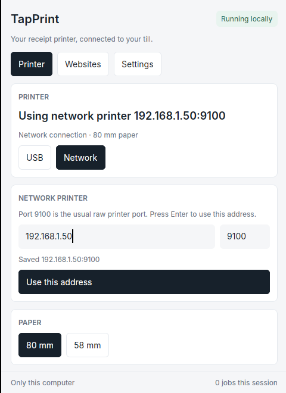

# TapPrint

Print receipts from a web page with no print dialog and no printer driver.

TapPrint is a tray app for macOS, Windows, and Linux. Your page sends a receipt image; TapPrint prints it on a USB or network thermal printer.



## Install

1. Download from [Releases](https://github.com/kongpda/tapprint/releases) and open it. On a Mac, take `arm64` for Apple silicon (M1 and later) or `x86_64` for Intel. Builds are unsigned, so allow it once: **Open Anyway** on macOS (System Settings > Privacy & Security), **More info > Run anyway** on Windows.
2. Connect the printer.
   - **USB:** set the printer's USB port to **Printer Class**.
   - **Network:** choose **Network**. TapPrint looks for printers on your network; click yours. Or type its address.
3. Click **Print test**.

Nothing is installed on Windows or Linux: it is one program file you can run from any folder. Linux needs a udev rule for USB printers. See [docs/building.md](docs/building.md#linux-usb-notes).

## Print from your page

Copy [`client/tapprint.js`](client/tapprint.js) into your site.

```js
import { TapPrint } from "./tapprint.js";

const till = new TapPrint({ clientName: "MyShop" });

if (!till.isPaired()) await till.pair(); // click Allow in the TapPrint window, once
await till.print(canvas, { drawer: true });
```

Draw the canvas 512 px wide for 80 mm paper, or 360 px for 58 mm.

Before going live, read [Going live on a real website](docs/deploying.md): the page must be on HTTPS.

Safari needs one extra step: in TapPrint, open **Settings** and click **Set up** beside **Safari**.

## Print from a server

One computer with the printer can print for a whole team. TapPrint asks a print server for jobs, so people can print from any phone or laptop.

The ready-made builds use [KHEvents](https://khevents.app). There, an owner or admin opens **Console**, **Printers**, **Add a printer**. In TapPrint, open **Websites**, type the code under **Print from KHEvents** and click **Connect**. See [Print from KHEvents](docs/server-printing.md).

To use your own server, build TapPrint with `TAPPRINT_PRINT_SERVER=https://your.server` and have the server speak the [print station protocol](docs/print-station-protocol.md).

## Updates

TapPrint looks for a new version once a day and shows it in the window. Click **Update** and it installs and restarts. It never updates by itself, so a sale is not interrupted.

## Security

TapPrint listens only on this computer. A site can print only after the person at the till clicks **Allow**, and can be removed in the window at any time.

- Serve your till page over HTTPS. TapPrint warns about plain http sites, and **Only secure websites** in Settings refuses them.
- Keep the manual pairing code (Settings) private. It works from any program on this computer.
- Leave **Raw printer commands** off unless your page needs it. Raw commands can change printer settings.
- Updates install only when you click **Update**, and only if the release is signed with the project's key.

To report a vulnerability, see [SECURITY.md](SECURITY.md). It also has the full threat model.

## Docs

- [Browser client](client/README.md)
- [Printing from other apps](docs/other-apps.md): POS software, scripts, the command line, with no window, or as a Rust library
- [Going live on a real website](docs/deploying.md)
- [HTTP API](docs/api.md), for `curl` and servers
- [Print from KHEvents](docs/server-printing.md) · [Print station protocol](docs/print-station-protocol.md)
- [Troubleshooting](docs/troubleshooting.md)
- [Windows code signing](docs/windows-signing.md)
- [Building from source](docs/building.md)
- [Contributing](CONTRIBUTING.md) · [Changelog](CHANGELOG.md)

## Licence

TapPrint is under the [MIT licence](LICENSE). Builds include libusb, which is under the LGPL-2.1, and other open source code: see [THIRD_PARTY_NOTICES.md](THIRD_PARTY_NOTICES.md).

TapPrint works with printers that understand ESC/POS commands. EPSON and ESC/POS are registered trademarks of Seiko Epson Corporation. TapPrint is not made or endorsed by Epson.
